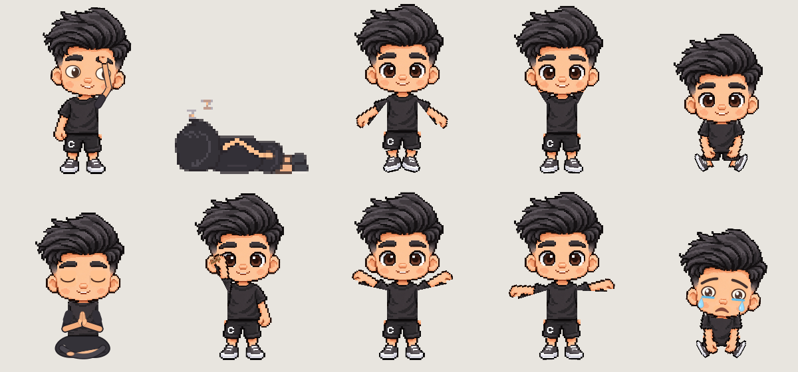

# Vynn Notify

**A little company for your desktop. / Một người bạn nhỏ trên desktop.**

[English](#english) · [Tiếng Việt](#tiếng-việt) · [English guide](USER_GUIDE.en.md) · [Hướng dẫn tiếng Việt](USER_GUIDE.md)



## English

Vynn Notify is an interactive pixel desktop pet for Windows. Say hello with a high-five, move Vynn around your screen, and set gentle reminders to drink water, rest your eyes and stretch between tasks.

**[Download Windows Lite EXE](https://github.com/vynnvu/VynnNotifyQPainter/raw/refs/heads/main/dist/Vynn_Notify_Lite.exe)** · [Visit the website](https://vynnvu.github.io/VynnNotifyQPainter/) · [Report an issue](https://github.com/vynnvu/VynnNotifyQPainter/issues)

Windows 64-bit · Approximately **31 MB download** · No Python installation required. Download size is not RAM usage. **The current app interface is Vietnamese**; the English guide translates the main controls.

### Meet Vynn

- **Playful interactions:** click once for a high-five; hold for about 0.2 seconds to pick Vynn up and drag.
- **Desktop movement:** walking, jumping, gravity and climbing detected surfaces, with intermediate routes when available.
- **Expressive poses:** sit, look around, groom, stretch, dance, feel sad or take a pixel-art nap.
- **Gentle reminders:** configurable water, eye-rest and stretching timers.
- **Time to focus:** a 25-minute focus session followed by a 5-minute break, plus a separate timed meditation mode.
- **Make it yours:** four character sizes, movement settings, editable dialogue and light/dark speech bubbles.

### Start in a minute

1. Download and open `Vynn_Notify_Lite.exe`. Allow a few seconds for startup.
2. Click Vynn to high-five, or hold the left button for 0.2 seconds and drag to move him.
3. Right-click Vynn for actions. Click his system-tray icon near the Windows clock to open settings.
4. Set reminders and focus timers. Closing settings keeps Vynn running; choose **Thoát Vynn Notify** to quit.

See the [English user guide](USER_GUIDE.en.md) for translations, settings, updating and troubleshooting.

### Before downloading

This is a work in progress. Surface detection varies between applications; not every visible object can be climbed. Reminders use timers you configure and do not monitor your health. Vynn uses window/UI information to detect surfaces.

Preferences are stored in `%APPDATA%\Vynn Notify`. Quit the old instance before replacing an EXE during updates.

If Vynn makes your day a little nicer, leave a star, share the project or [send feedback](https://github.com/vynnvu/VynnNotifyQPainter/issues).

[☕ Support this project](#support)

## Tiếng Việt

Vynn Notify là ứng dụng bạn đồng hành trên Windows. Bạn có thể đập tay, kéo Vynn đi chơi, chọn biểu cảm hoặc để Vynn nhắc uống nước, nghỉ mắt và giãn cơ giữa những giờ làm việc.

**[Tải Vynn Notify Lite](https://github.com/vynnvu/VynnNotifyQPainter/raw/refs/heads/main/dist/Vynn_Notify_Lite.exe)** · [Trang giới thiệu](https://vynnvu.github.io/VynnNotifyQPainter/) · [Hướng dẫn sử dụng](USER_GUIDE.md)

Windows 64-bit · File tải khoảng **31 MB** · Không cần cài Python. Dung lượng file tải không phải mức RAM sử dụng. Giao diện ứng dụng hiện bằng tiếng Việt.

### Tính năng chính

- **Tương tác bằng chuột:** bấm nhanh để đập tay, giữ khoảng 0,2 giây rồi kéo để di chuyển.
- **Chuyển động trên desktop:** đi bộ, nhảy, rơi theo trọng lực và tìm chỗ leo qua những bề mặt được nhận diện.
- **Nhiều động tác:** ngồi nghỉ, quan sát, vuốt tóc, vươn vai, nhảy múa, buồn và ngủ kiểu pixel.
- **Nhắc nghỉ ngơi:** tùy chỉnh chu kỳ uống nước, nghỉ mắt và giãn cơ.
- **Hẹn giờ:** tập trung 25 phút, nghỉ 5 phút hoặc thiền theo thời gian bạn chọn.
- **Tùy chỉnh:** bốn kích thước, tốc độ đi lại, lời thoại và bong bóng sáng/tối.

### Bắt đầu nhanh

1. Tải và mở `Vynn_Notify_Lite.exe`; chờ vài giây để Vynn xuất hiện.
2. Bấm để đập tay; giữ chuột trái 0,2 giây rồi kéo để di chuyển.
3. Chuột phải vào Vynn để chọn hành động. Bấm biểu tượng khay hệ thống cạnh đồng hồ để mở bảng điều khiển.
4. Chỉnh nhắc nhở và thời gian tập trung. Đóng bảng vẫn giữ Vynn chạy; chọn **Thoát Vynn Notify** để tắt.

Xem [hướng dẫn đầy đủ](USER_GUIDE.md) nếu cần giải thích từng tùy chọn.

### Lưu ý

Ứng dụng đang được hoàn thiện. Khả năng đứng và leo phụ thuộc từng cửa sổ; không phải vật thể nào cũng được nhận diện. Lời nhắc chạy theo thời gian bạn đặt, không tự phát hiện tình trạng sức khỏe. Ứng dụng có sử dụng thông tin cửa sổ/UI để tìm bề mặt.

Dữ liệu lưu tại `%APPDATA%\Vynn Notify`. Khi cập nhật EXE, thoát bản cũ trước khi thay file.

Nếu bạn thích Vynn, hãy tặng dự án một ngôi sao, chia sẻ hoặc [gửi góp ý](https://github.com/vynnvu/VynnNotifyQPainter/issues).

<a id="support"></a>

## ❤️ Support This Project / Ủng hộ dự án

If you enjoy Vynn Notify QPainter, you can buy me a coffee! ☕ Your support helps me maintain and improve this project.

**Donations are entirely voluntary and are not required to download or use the software.**

Nếu bạn yêu thích Vynn Notify QPainter và muốn hỗ trợ phát triển ứng dụng, bạn có thể mời mình một ly cà phê! ☕

Sự ủng hộ của bạn giúp mình có thêm thời gian duy trì, sửa lỗi và cải thiện dự án.

**Donate hoàn toàn tự nguyện, không bắt buộc để tải xuống hoặc sử dụng phần mềm.**

### ☕ Donate via VietQR / Ủng hộ qua VietQR

Scan the QR code with a compatible banking app. You can choose any amount you wish to contribute.

Quét mã QR bên dưới bằng ứng dụng ngân hàng có hỗ trợ. Bạn có thể tùy chọn số tiền muốn ủng hộ.


Thank you for your support! / Cảm ơn bạn đã ủng hộ Vynn! ❤️

## Development / Phát triển

```powershell
py -3.11 -m venv .venv
.\.venv\Scripts\python.exe -m pip install -r requirements.txt
.\.venv\Scripts\python.exe main.py
```

`run.bat` stops the previous recognized instance and starts a new source session. `build.bat` packages the standalone EXE using `Vynn_Notify.spec`. The build excludes unused Qt components.

```powershell
.\.venv\Scripts\python.exe smoke_check.py
.\.venv\Scripts\python.exe -m unittest test_navigation.py test_surfaces.py
```

The EXE also accepts `--self-test` for a temporary-data rendering/settings check. Set `QT_QPA_PLATFORM=offscreen` to run it without visible windows.

### English website / Trang giới thiệu tiếng Anh

The static site is in [`docs/`](docs/). See [deployment instructions](WEBSITE.md) to enable GitHub Pages and preview locally. Its expected URL after enabling Pages is `https://vynnvu.github.io/VynnNotifyQPainter/`.

### Licensing / Giấy phép

This repository does not yet declare a project license or a complete asset-rights record. Public source availability alone is not a license to redistribute or sell it. Third-party libraries retain their respective licenses. See [Qt licensing](https://doc.qt.io/qt-6/licensing.html).
